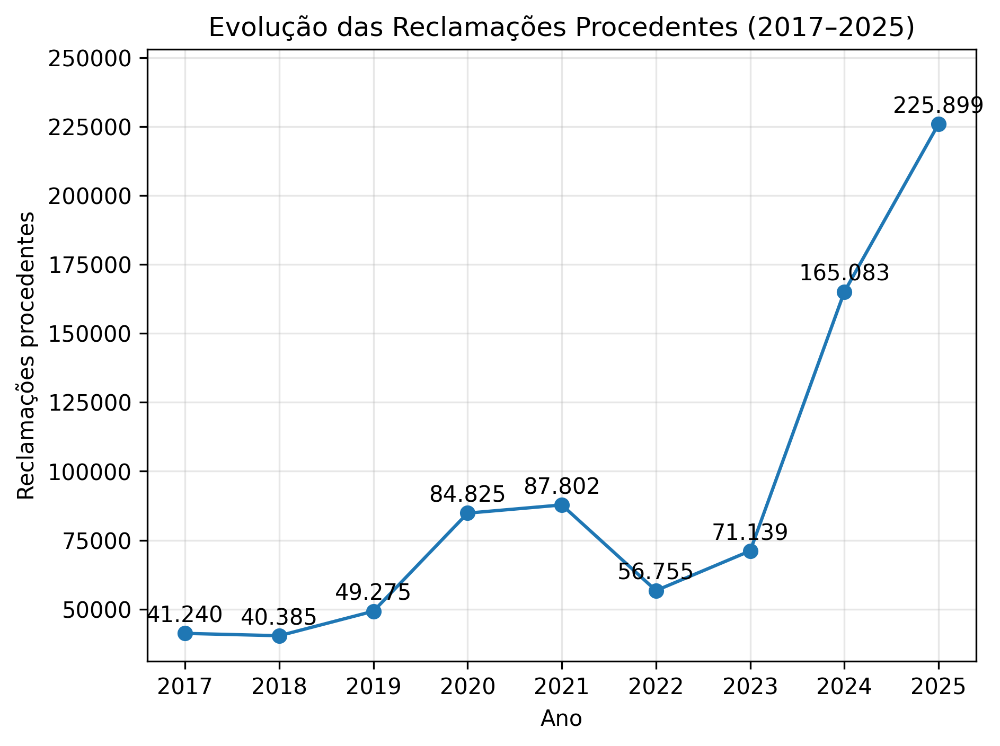

# 📊 Análise de Reclamações no Setor Bancário Brasileiro

Projeto de análise de dados utilizando informações públicas do Banco Central
do Brasil para estudar a evolução das reclamações relacionadas às instituições
financeiras brasileiras entre 2017 e 2025.

## 🎯 Objetivo

Analisar os dados públicos do Ranking de Reclamações do Banco Central,
identificando padrões, evolução ao longo do tempo, instituições com maior
volume de reclamações procedentes e possíveis mudanças no comportamento
dos dados ao longo dos anos.

O projeto envolve coleta, tratamento, análise exploratória e visualização
dos dados utilizando Python.

## 🛠️ Tecnologias

- Python
- Pandas
- Requests
- Matplotlib
- Git/GitHub

## 📂 Estrutura do projeto

- `src/` — scripts de coleta, tratamento, análise e visualização
- `data/` — dados coletados e bases consolidadas
- `outputs/` — gráficos gerados durante a análise
- `notebooks/` — análises exploratórias
- `dashboard/` — etapa futura de visualização em Power BI

## 🔎 Etapas do projeto

### Coleta e preparação dos dados

Os dados foram obtidos a partir do Ranking de Reclamações disponibilizado
pelo Banco Central do Brasil.

Foram identificados e coletados os períodos trimestrais disponíveis,
consolidando os dados históricos em uma única base para análise.

A base consolidada contém informações como:

- ano;
- trimestre;
- instituição financeira;
- reclamações procedentes;
- total de reclamações;
- quantidade de clientes.

### Análise exploratória

A análise buscou identificar:

- evolução anual das reclamações;
- instituições com maior volume de reclamações procedentes;
- comportamento das principais instituições ao longo do período;
- mudanças relevantes na série histórica.

Durante a análise foi identificado um aumento expressivo das reclamações
procedentes em 2024 e 2025.

### Investigação do aumento das reclamações

A série histórica apresentou:

- **2023:** 71.139 reclamações procedentes
- **2024:** 165.083 reclamações procedentes
- **2025:** 225.899 reclamações procedentes

Isso representa um crescimento de aproximadamente **132% entre 2023 e 2024**,
seguido por novo crescimento de aproximadamente **37% em 2025**.

A análise por instituição mostrou que o movimento não ocorreu de forma
uniforme entre os bancos, indicando a importância de analisar a evolução
individual das instituições.

> O ano de 2026 não foi utilizado nas comparações anuais completas porque
> os dados disponíveis correspondem apenas a uma parte do ano.

## 📈 Visualizações

### Evolução das reclamações procedentes



O gráfico evidencia a mudança de patamar observada principalmente a partir
de 2024.

### Top 10 instituições em 2025


O ranking permite identificar quais instituições apresentaram os maiores
volumes de reclamações procedentes em 2025.

### Evolução das principais instituições


A comparação histórica ajuda a verificar como diferentes instituições
contribuíram para a evolução das reclamações ao longo do período.

## 💡 Principais insights

- A série apresenta uma mudança significativa de patamar em 2024.
- O número de reclamações procedentes passou de **71 mil em 2023 para 165 mil em 2024**.
- Em 2025, o volume chegou a aproximadamente **226 mil reclamações procedentes**.
- Bradesco apresentou o maior volume de reclamações procedentes em 2025.
- A evolução varia significativamente entre as instituições, mostrando que o crescimento agregado não deve ser interpretado isoladamente.
- Mudanças na estrutura dos dados do Banco Central ao longo da série também precisam ser consideradas na interpretação dos resultados.

## 🚀 Próxima etapa

A próxima etapa do projeto será a construção de um **dashboard em Power BI**
para transformar os resultados da análise em uma visualização interativa,
permitindo explorar períodos, instituições e indicadores.

## ⚙️ Configuração do ambiente

Este projeto utiliza um ambiente virtual Python (`venv`) para isolar as
dependências e garantir maior organização e reprodutibilidade.

### 1. Clonar o repositório

```bash
git clone https://github.com/thalesfreirefarias/churn-bancario-brasil.git
cd churn-bancario-brasil
```

### 2. Criar o ambiente virtual

```bash
python3 -m venv .venv
```

### 3. Ativar o ambiente virtual

No macOS/Linux:

```bash
source .venv/bin/activate
```

### 4. Instalar as dependências

```bash
pip install -r requirements.txt
```

A pasta `.venv` não é versionada no GitHub. As dependências necessárias
para reproduzir o ambiente são registradas no arquivo `requirements.txt`.