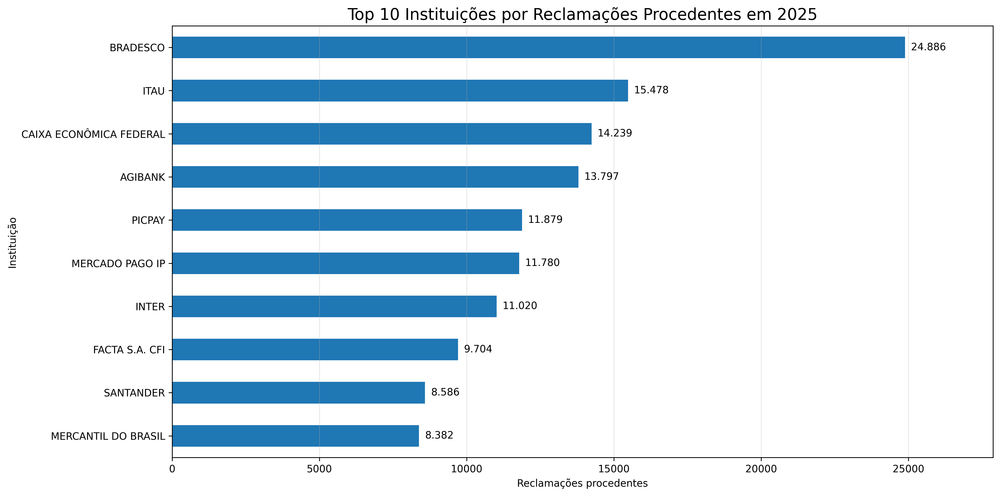
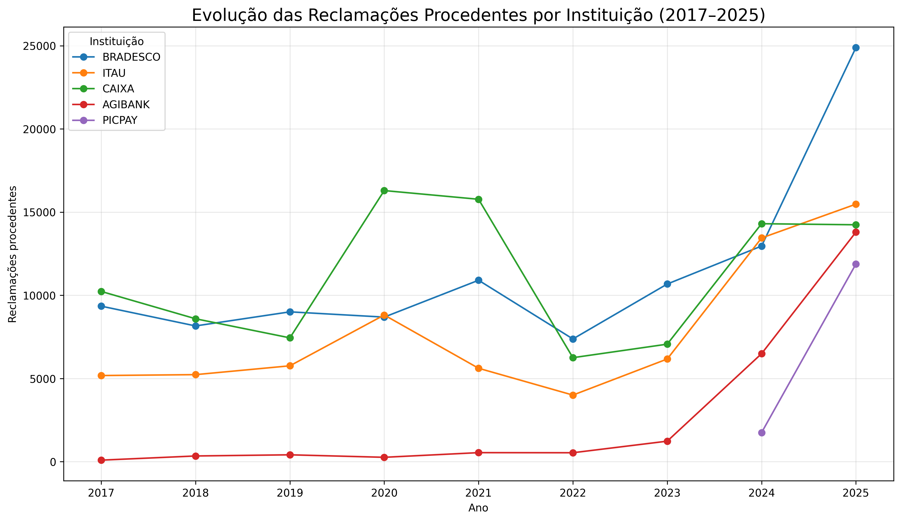

# 📊 Brazilian Banking Complaints Analysis

### Central Bank Open Data | Python | Pandas | Exploratory Data Analysis

An end-to-end data analytics project exploring customer complaints against financial institutions in Brazil using publicly available data from the Central Bank of Brazil (BCB).

The project investigates historical trends, complaint volumes, differences across financial institutions, and significant changes observed between 2017 and 2025.

---

## 📌 Project Overview

Customer complaints are an important indicator of service quality and potential operational challenges in the financial sector.

Analyzing these records can help identify patterns, monitor institutional performance, and support data-driven decisions.

This project collects, processes, consolidates, and analyzes public banking complaints data using Python.

**Data source:** Central Bank of Brazil — Banking Complaints Ranking.

**Analysis period:** 2017–2025.

**Additional data:** Partial 2026 records may be available in the dataset but are excluded from full-year comparisons.

> This project analyzes banking complaints, not actual customer churn or account closures.

---

## 🎯 Objectives

- Collect historical complaints data from the Central Bank of Brazil.
- Consolidate reporting periods into a structured dataset.
- Analyze the evolution of complaints over time.
- Identify financial institutions with the highest complaint volumes.
- Investigate significant changes in the historical series.
- Generate visualizations to communicate analytical findings.
- Explore potential business implications for the banking sector.

---

## 🛠️ Technologies

- **Python** — Data collection and analysis
- **Pandas** — Data manipulation and aggregation
- **Requests** — REST API integration
- **Matplotlib** — Data visualization
- **Git & GitHub** — Version control and project documentation

---

## 📂 Project Structure

```text
churn-bancario-brasil/
│
├── data/
│   └── Collected and consolidated datasets
│
├── src/
│   ├── 01_coleta_dados.py
│   ├── 02_coleta_reclamacoes.py
│   ├── 03_coleta_dados_reclamacoes.py
│   ├── 04_analise_exploratoria.py
│   ├── 05_investigacao_reclamacoes.py
│   └── 06_visualizacoes.py
│
├── outputs/
│   └── Generated charts and visualizations
│
├── notebooks/
│   └── Reserved for exploratory notebooks
│
├── sql/
│   └── Reserved for SQL analysis
│
├── dashboard/
│   └── Reserved for dashboard development
│
├── .gitignore
├── requirements.txt
└── README.md
```

The numbered Python scripts organize the analytical workflow from data collection to visualization.

The `notebooks`, `sql`, and `dashboard` directories are included in the repository structure; their contents are not required for the findings documented here.

---

## 🔄 Data Analytics Workflow

### 1. Data Collection

The project accesses the Central Bank of Brazil's public complaints ranking API.

The initial collection script retrieves available years, reporting frequencies, periods, and categories.

The information is transformed into a Pandas DataFrame and exported as a CSV file.

### 2. Data Preparation

Historical reporting periods are collected and consolidated for analysis.

The resulting dataset includes information such as:

- Year and reporting period
- Financial institution
- Substantiated complaints
- Total complaints
- Number of customers

### 3. Exploratory Data Analysis

The analysis focuses on:

- Annual complaint trends
- Financial institutions with the highest complaint volumes
- Historical changes across institutions
- Significant variations in the aggregated data

### 4. Investigation and Visualization

Additional analysis investigates the increase in substantiated complaints observed during 2024 and 2025.

Charts are generated to communicate the main findings and compare institutional trends.

---

## 📈 Key Findings

### 1. Evolution of Substantiated Complaints

The analysis identified a significant increase in substantiated complaints between 2023 and 2025.

| Year | Substantiated Complaints | Annual Change |
|------|-------------------------:|--------------:|
| 2023 | 71,139 | — |
| 2024 | 165,083 | +132.1% |
| 2025 | 225,899 | +36.8% |

Between 2023 and 2025, the reported number of substantiated complaints increased by approximately **217.5%**.


The chart illustrates the change in the historical series, particularly from 2024 onward.

### 2. Top 10 Financial Institutions in 2025

The analysis compares financial institutions according to their total number of substantiated complaints in 2025.



According to the project's findings, **Bradesco recorded the highest absolute volume of substantiated complaints in 2025**.

Absolute complaint volumes should not be interpreted as a direct measure of service quality because financial institutions differ in customer base size and other characteristics.

### 3. Historical Comparison Across Institutions

The project also examines how complaint volumes evolved across major financial institutions.



The comparison indicates that the increase in complaints was not uniform across institutions.

This highlights the importance of investigating institution-level trends rather than relying exclusively on aggregated totals.

---

## 💡 Business Insights

### Customer Experience Monitoring

Historical complaints data can support the identification of periods and institutions that may require additional investigation.

### Operational Risk Analysis

Significant changes in complaint volumes may help prioritize further analysis of operational processes and customer service.

### Performance Benchmarking

Comparisons across institutions can provide useful context, particularly when supported by normalized indicators such as complaints per customer.

### Data-Driven Decision-Making

Public regulatory data can complement internal operational indicators and support business intelligence initiatives.

These are potential applications of the analysis, not validated outcomes of implemented business actions.

---

## ⚠️ Data Limitations

The findings should be interpreted with the following considerations:

- The dataset contains complaints registered through the Central Bank's reporting framework.
- Absolute complaint volumes are influenced by the size and characteristics of each institution.
- Changes in reporting methodology, institutional coverage, or data structure may affect historical comparisons.
- An increase in recorded complaints does not necessarily establish a proportional deterioration in service quality.
- Partial-year data should not be compared directly with complete annual totals.
- Banking complaints are not equivalent to customer churn.

The figures reported in this README reflect the project's documented analysis and should be revalidated against the consolidated dataset when the data is updated.

---

## ⚙️ Environment Setup

### 1. Clone the repository

```bash
git clone https://github.com/thalesfreirefarias/churn-bancario-brasil.git
cd churn-bancario-brasil
```

### 2. Create a virtual environment

```bash
python -m venv .venv
```

### 3. Activate the environment

**Windows:**

```bash
.venv\Scripts\activate
```

**macOS / Linux:**

```bash
source .venv/bin/activate
```

### 4. Install dependencies

```bash
pip install -r requirements.txt
```

### 5. Explore the source code

The numbered scripts are available in the `src/` directory.

Start with:

```text
src/01_coleta_dados.py
```

This script identifies the reporting periods available through the Central Bank API and exports them to:

```text
data/periodos_ranking.csv
```

Additional scripts cover complaint data collection, exploratory analysis, investigation, and visualization.

Execution of the full workflow may require checking local file paths and the current availability of the API.

---

## 🔗 Data Source

**Central Bank of Brazil (BCB)**

Public Banking Complaints Ranking API:

https://www3.bcb.gov.br/rdrweb/rest/ext/ranking

The Central Bank is the source of the public data. The analysis and interpretations presented here are part of an independent portfolio project.

---

## 🚀 Future Improvements

- Expand data validation and reproducibility checks.
- Explore normalized complaint indicators.
- Document potential structural changes in the historical series.
- Connect the analytical findings to an interactive dashboard.
- Extend the analysis as new reporting periods become available.

---

## 👨‍💻 Author

**Thales Farias**

Data Analytics | Business Intelligence | Financial Services

📍 São Paulo, Brazil

[GitHub](https://github.com/thalesfreirefarias)

---

*Transforming public financial data into meaningful analytical insights.*
